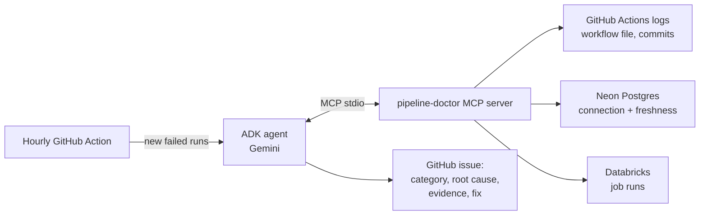

# Pipeline Doctor 🩺

**An AI on-call engineer for data pipelines.** When a pipeline run fails, a Google ADK agent
investigates it through MCP tools (logs, workflow file, recent commits, database, Databricks),
finds the root cause, and opens a GitHub issue with the evidence and the fix.

It watches my two live pipelines:
[India Air Quality](https://github.com/Lokesh4561/india-air-quality-pipeline) (GitHub Actions + Neon Postgres) and
[Wikipedia Pulse](https://github.com/Lokesh4561/wikipedia-pulse) (Databricks + GitHub Actions).
The evaluation set is built from failures I actually had to debug by hand: IPv6 routing to Neon,
a wrong password, a secret pasted in the wrong format, a broken workflow YAML, the Databricks
free-tier quota, a 429 from a news API, and LLM timeouts.



## Results

See **[eval/RESULTS.md](eval/RESULTS.md)**: 25 failure cases (7 real, 18 realistic), the full agent
vs. a baseline that may only read the log.
The category definitions in the prompt were added after the first run (v1: names only), so later
runs on the same 25 cases are a development score, not a held-out test. Metrics: root-cause category accuracy, fix accuracy,
tool calls, whether it reads the log first, planted secrets leaked, latency p50/p95.

## Live dashboard

**https://lokesh4561.github.io/pipeline-doctor/** shows each pipeline's latest run and 30-run history,
the agent's diagnoses, and the evaluation, read live from the GitHub API in the browser (`docs/index.html`).

## How it works

| Piece | File | What it does |
|---|---|---|
| MCP server | `doctor/mcp_server.py` | Exposes 6 **read-only** tools over stdio; any MCP client can use them |
| Tools | `doctor/tools.py` | `list_recent_runs`, `get_failed_log`, `get_workflow_file`, `recent_commits`, `check_database`, `databricks_job_runs` |
| Agent | `doctor/agent.py` | Google ADK `LlmAgent` + `McpToolset`; returns strict JSON (category, root cause, evidence, fix, confidence) |
| Watcher | `doctor/cli.py` | Finds new failed runs, diagnoses up to 3 per hour, opens one issue per run (never twice) |
| Evaluation | `eval/` | Replays recorded tool answers, so results are repeatable and cost nothing but LLM calls |

**Guardrails**
- Tools are read-only. The agent suggests fixes; a human applies them.
- Every log, error and issue body passes through `redact()`, which strips database passwords,
  GitHub, Gemini and Databricks tokens. The eval plants a secret in a log and checks it never leaks.
- Logs are trimmed to the error lines plus the tail, so the model reads the first real error, not 10,000 lines.
- The answer must be one of 11 categories, with `unknown` allowed when the evidence is thin.

## Run it

```bash
pip install -r requirements.txt
python -m pytest -q                                  # offline tests, no API keys needed

export GOOGLE_API_KEY=...                            # Gemini API key (free tier works)
python -m eval.evaluate --only aq-ipv6-unreachable   # one replayed case
python -m doctor.cli diagnose --repo Lokesh4561/india-air-quality-pipeline --run-id <id>
```

**GitHub setup** (Settings → Secrets and variables → Actions)

| Name | Type | Value |
|---|---|---|
| `GEMINI_API_KEY` | secret | Gemini API key |
| `DOCTOR_GH_TOKEN` | secret | fine-grained token: Actions read on the watched repos, Issues read/write on this repo |
| `WATCH_REPOS` | variable | `Lokesh4561/india-air-quality-pipeline,Lokesh4561/wikipedia-pulse` |
| `DATABASE_URL`, `DATABRICKS_HOST`, `DATABRICKS_TOKEN` | secrets | optional, enable the database and Databricks tools |

**Use the tools from Claude Desktop or VS Code** (any MCP client):

```json
{"mcpServers": {"pipeline-doctor": {"command": "python", "args": ["-m", "doctor.mcp_server"],
  "cwd": "/path/to/pipeline-doctor", "env": {"DOCTOR_GH_TOKEN": "..."}}}}
```

## Limitations

- 18 of the 25 cases are written by me in the style of real logs; 7 come from real incidents.
- The fix check is keyword-based, so it can miss a correct fix phrased differently.
- Free-tier Gemini limits how many failures it diagnoses per hour (3).
